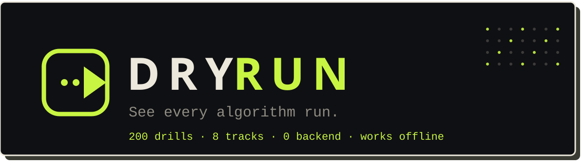

<p align="center">
  
</p>

# DRYRUN, see every algorithm run

Paste a LeetCode link. Get a beginner and an optimized solution, an animated
step-by-step trace, a memory trick and an Anki card, all on one page.
**200 curated drills across 8 role tracks**, 117 unique problems, all working
offline as pure static files. No build step, no backend, no sign-up.

<p align="center">
  
</p>

## What you get per problem

| # | Piece | What it does |
|---|-------|--------------|
| 01 | Trace | Animated run on a tiny example. Pointers glide, cells swap, stacks grow. Click the stage, then use arrow keys and space. Speeds 0.5x, 1x, 2x. |
| 02 | Two variants | Beginner-friendly first, optimized second. Same signature, side by side (stacked on phones, side by side on wide screens). |
| 03 | Diff morph | The brute force transforms into the best version, one highlighted change at a time. Then a complexity race you can scale with a slider. |
| 04 | Remember it | One vivid hook per problem plus the real system it shows up in, and a ready-made Anki card. |

## Quickstart

```bash
python3 -m http.server 8000      # then open http://localhost:8000
```

Deploy the folder as-is to GitHub Pages, Cloudflare Pages, Netlify or any
static host. `dist/dryrun.html` is the same site as one self-contained file
(only the Google Fonts link is external, and it falls back gracefully offline).

## Routes

| Route | Page |
|-------|------|
| `#/` | Home, URL box, tracks, stats, providers |
| `#/t/<track>` | Track table, filters, done checkboxes, bulk Anki export |
| `#/p/<slug>` | Problem: trace, variants, morph, race, trick, Anki |
| `#/gen/<slug>` | Generate a page for a URL outside the library (needs an AI key) |
| `#/mine` | Problems you generated, stored in this browser |
| `#/data` | Progress, backup export/import, storage use |
| `#/anki` | Anki setup guide: AnkiConnect, origins, local clone |

## Tracks (25 drills each)

| Track | Focus |
|-------|-------|
| Data Science | Counting, ranking, streaming stats, sampling, sequence similarity |
| AI Engineer | Caches, tries and prefix search, token style DP, schedulers, streaming |
| Forward Deployed Engineer | Messy data, parsers, rate limits, integrations, graph joins |
| AI/ML Researcher | Numerics, sampling, dynamic programming, graph optimisation |
| Software Engineer | General interview core across patterns |
| Backend Engineer | Caches, rate limiters, schedulers, dependency graphs, structure design |
| Frontend Engineer | JS utilities, debounce and throttle, async, DOM style problems |
| Core Developer | Low level structures, bits, math, pointers |

Problems are shared across tracks by slug, so the 200 drills cover 117 unique
problems. Edit the `ids` arrays in `js/data/tracks.js` to re-curate.

## Your data stays yours

Everything lives in `localStorage`. Nothing is uploaded anywhere.

| Key | Holds |
|-----|-------|
| `dr-done` | Problems marked done |
| `dr-mine` | AI generated problems |
| `dr-ai` | Provider, base URL, model, key (per provider) |
| `dr-theme` | Light or dark |
| `dr-session` | Visit count and where you left off (powers the Continue chip) |

Open `#/data` to see progress bars, export one JSON backup, import it on another
device, or erase everything.

## Anki

* **Download cards**: tab-separated `.txt`, 2 cards per problem (pattern recall,
  write the code). Anki: File, Import, enable Allow HTML.
* **Send to Anki**: pushes to desktop Anki through AnkiConnect (add-on code
  `2055492159`). Keep desktop Anki open and add this site's origin to the
  add-on's `webCorsOriginList`. If a push fails, the site points at the
  in-app `#/anki` guide instead of a dead end.

## AI for new problems

Settings (key icon, top right) accepts any OpenAI-compatible
`/chat/completions` endpoint, plus Anthropic directly. Presets: Groq, Google
Gemini, OpenRouter, Cerebras, Mistral, GitHub Models, NVIDIA NIM,
Hugging Face, DeepSeek, Qwen, OpenAI, Anthropic, Pollinations (experimental)
and Custom. Free tiers and model names change often, use *List models* or edit
the Model field. Keys stay in your browser and go only to the provider you
pick. **AI output is unverified, read the code before trusting it.**

## Add a problem

Add a record to any `js/data/pN.js` with `DR.add({...})`:

```text
id (LeetCode slug), n (number), t (title), d ('E'|'M'|'H'), tg (tags),
pat (pattern name), br (one line brief),
bt/bs (variant 1 time/space), ot/os (variant 2 time/space),
b (variant 1 code), o (variant 2 code),
trick, real, viz, lang ('py' default | 'js'),
test + exp (python) or jt + je [+ jeb] (js)
```

* In code, a trailing `#? note` (JS: `//? note`) marks a slow line in variant 1
  (red). `#! note` (JS: `//! note`) marks a key line in variant 2 (green).
  The diff morph and the complexity race derive automatically from the two
  code strings.
* `viz` is either a simulator spec such as `{sim:'window', ...}` (see
  `js/sims.js`) or `{flow:[DR.f(note, cells, {h,g,x,p,w,aux,grid,...}), ...]}`
  for a hand-written trace.
* Data files use `String.raw`, so code must not contain backticks or `${`.
* Add the slug to a track in `tracks.js`, then run the checks below.

## Verification (what was actually run)

```bash
node tools/dump.js > /tmp/dr.json && python3 tools/check.py /tmp/dr.json  # both variants of every python problem + track integrity
node tools/checkjs.js                                                       # both variants of every JS problem (async, real timers)
node tools/frames.js                                                        # every animation generates valid frames
npm i jsdom && node tools/smoke.js                                          # every route, dropdowns, tabs, morph, race, AI retry path (mocked), Anki
python3 tools/bundle.py                                                     # dist/dryrun.html
```

Current state: 206 variant runs with 0 failures, 28 JS variant runs with
0 failures, all 117 frame sets valid, 1242 smoke checks green.
Not covered: pixel-perfect rendering in every browser, and the real
third-party endpoints (they need network and keys).

## Layout

```text
index.html                  # shell, hero, views, dialog
css/style.css               # design system: dark first, cream ink, volt lime accent
js/hl.js                    # syntax highlight, diff, complexity maths + DRUI custom dropdown
js/sims.js                  # pattern simulators that emit trace frames
js/viz.js                   # trace player, code renderer, morph diff, race
js/anki.js                  # TSV download + AnkiConnect push
js/ai.js                    # BYO key generation for new problems
js/app.js                   # router, pages, settings, data backup
js/data/boot.js             # registry DR.P / DR.T + helpers
js/data/p1..p7.js           # 117 problems in two variants with tests
js/data/tracks.js           # 8 role tracks
assets/                     # README banner + animated preview (pure SVG, no JS)
tools/                      # dump, check, checkjs, frames, smoke, bundle
dist/dryrun.html            # single file build (generated, commit it)
```

Not affiliated with LeetCode. Problem titles belong to their owners.
Explanations, code and visuals here are original.
